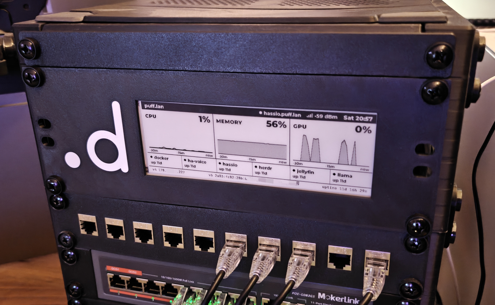

# 🔎 ESP32 CrowPanel Observability

ESPHome + LVGL firmware for the Elecrow CrowPanel ESP32-S3 5.79" e-paper
(792×272, black/white)
[[Source](https://www.elecrow.com/wiki/CrowPanel_ESP32_E-paper_5.79-inch_HMI_Display.html)].

It shows homelab status from any monitoring-style Home Assistant
integration, like the Proxmox integration. CPU, memory and GPU charts, service up/down tiles, public IPv4/IPv6, and connectivity.

> The 2U 10" Rack Mount can be found in the assets directory with and without the logo

## What you need

- **The panel:** Elecrow CrowPanel ESP32-S3 5.79" e-paper.
- **A USB-C data cable** and **Chrome** (or Edge), for the first flash only.
- **Home Assistant** with the **ESPHome Device Builder** add-on.
- **Proxmox** Integration setup in Home Assistant.
- **Entities in HA** for what you want shown (see [Settings](#settings)). Until then, the panel runs on demo data.

## Setup

The add-on holds a small device YAML (from `ha-stub.yaml.example`) with your
Wi-Fi, API key, and settings. It pulls everything else from this repo at
build time. **Secrets, entity IDs, and LAN addresses stay in that YAML on HA,
never in this repo.**

**1 → Create the device in the add-on.** Click **New device**, name it `crowpanel`, and pick ESP32-S3. Then edit its YAML: paste `ha-stub.yaml.example`, but keep the API key and AP password the add-on generated. Set `ntp_server` (see the note below).

**2 → First flash over USB.** Factory firmware can't do OTA. In the add-on, use **Install → Manual download → Factory format**. Then flash the file with [web.esphome.io](https://web.esphome.io) in Chrome, with the panel plugged in. The panel shows `DEMO DATA - NOT LIVE`.

**3 → Add it to Home Assistant.** Settings → Devices & services → Discovered → crowpanel (or Add integration → ESPHome). **The add-on alone does not do this.** Without it, no entity states reach the panel, and it stays on `Waiting for Home Assistant...`.

**4 → Switch to live data.** In the device YAML, change the last package from `packages/data_demo.yaml` to `packages/data_ha.yaml`. Set the entity substitutions from [Settings](#settings).

**5 → Install → Wirelessly.** Do this after every settings change. The add-on fetches the latest `main` on each build (`refresh: 0s`).

**Time needs an NTP server the panel can reach.** If its network has no internet, point `ntp_server` at your router or another LAN server. Without it, the clock shows `--:--`. The timezone comes from the HA host.

### Updating

Since the device yaml points to this repo, after updates have been pushed, you simply need to hit "Update" or "Install" in ESPHome Device Builder to flash the latest changes to your device.

## Settings

All settings are substitutions in the device YAML on HA. Change them, Save, then Install.

**Entities** (only with `data_ha.yaml`; a value containing `TODO` means "not set"):

| Substitution | Expected entity | Notes |
|---|---|---|
| `entity_cpu`, `entity_mem`, `entity_gpu` | `sensor`, % (0-100) | Proxmox gives node CPU and memory %. GPU needs its own source. Unset shows `NOT WIRED`. |
| `entity_ip4`, `entity_ip6` | any entity, state = address | Check IPv6 is the address you want (prefix vs host, temporary vs stable). |
| `entity_svc1` .. `entity_svc6` | anything `on`/`off` | Health check, ping, or Proxmox guest status |
| `entity_svc1_uptime` .. `_svc6_uptime` | `sensor`, device_class `uptime` | Drives `up 12d`. Proxmox gives `sensor.<guest>_uptime`. |
| `entity_uptime` | `sensor`, device_class `uptime` | Host uptime in the footer |

**Names and labels:**

| Substitution | Default | Notes |
|---|---|---|
| `header_title` | `homelab` | Left of the header bar |
| `ha_label` | `home assistant` | Next to the HA connection LED |
| `svc1_name` .. `svc6_name` | `service-N` | About 9 characters fit. `""` hides the tile. |
| `svc1_up_when` .. `svc6_up_when` | `"on"` | Use `"off"` for `problem`-class sensors |

**Tuning:**

| Substitution | Default | Notes |
|---|---|---|
| `ntp_server` | `pool.ntp.org` | Needs internet; set a LAN server if there is none |
| `alert_pct` | `90` | At or above this, the metric caption inverts |
| `full_refresh_every` | `60` | Full refresh (clears ghosting) every N redraws, ~hourly |
| `offline_grace_s` | `120` | Seconds without HA or Wi-Fi before the `OFFLINE` banner |
| `log_level` | `INFO` | `DEBUG` only while troubleshooting; it logs entity states, including IPs |

### Entity tips

- **Proxmox API token needs its own ACL.** With "Privilege Separation" on, a token ignores its user's and group's roles. Without an ACL, the node shows up with zero entities:
  `pveum acl modify / --tokens '<user>@pve!<token>' --roles PVEAuditor`
- **Proxmox `*_status` sensors mean "running", not "healthy".** A container whose app crashed still shows UP.
- **A ping only proves the host answers.** For "is the app OK", prefer an HTTP check or the integration's own health entity.

## How it behaves

**Screen states:**

- **Services:** filled LED + `up 12d` when running. **DOWN** inverts the whole cell, with a hollow LED and `DOWN 4m`. Unknown or unavailable shows a thin hollow LED and `no data`, never the last known state.
- **Missing numbers** show `—`, never `0%`.
- **Charts** show the last 30 minutes on a fixed 0-100 % scale. **History starts empty after every reboot or update** and fills over 30 minutes.
- **`Waiting for Home Assistant...`** covers the header until the first data arrives.
- **`OFFLINE since HH:MM - values are stale`** covers the header after `offline_grace_s` without Wi-Fi or HA. E-paper keeps the last image, so this is what stops old values from looking current.
- **Demo data** shows an inverted `DEMO DATA - NOT LIVE` title and placeholder addresses.

**Refresh:**

- **At most one partial refresh (~0.6 s) per minute.** Values batch to the minute.
- **Immediate redraw** (2 s debounce) when a service changes state, or Wi-Fi or HA connects or drops.
- **Full refresh** (the panel flashes) every `full_refresh_every` redraws, at 03:00, and on a **long press of MENU (1-5 s)**.

## Development

Changing layout or behaviour means editing `packages/` and pushing to `main`;
the next Install picks it up. Local builds, testing, and how the code fits
together are in [`AGENTS.md`](AGENTS.md).

Display driver: [ESPboards/esphome-lvgl-crowpanel-epaper-5.79-4.2](https://github.com/ESPboards/esphome-lvgl-crowpanel-epaper-5.79-4.2),
pinned by commit in `packages/board.yaml`.

## License

[MIT](LICENSE)
